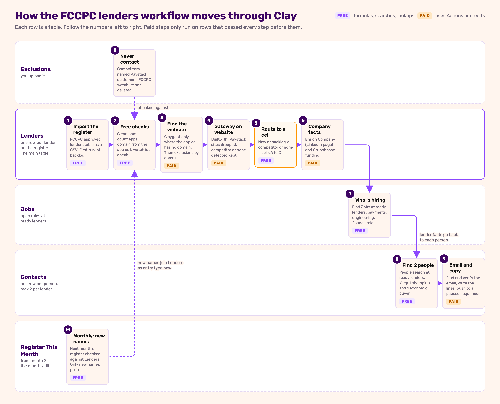

# Clay Build Guide: FCCPC Newly Approved Digital Lenders (Paystack)

A step-by-step guide to building [workflow-spec.md](../workflow-spec.md) (in this folder) in Clay. Written for someone who has never built anything in Clay. Follow the parts in order. Each step tells you **why** it exists, **what to click**, **what to type**, **how to check it worked** and **what it costs**.

> **Don't skip the checks.** The most common Clay mistake is running a paid column on 500 rows before checking it worked on 1. The spec says the backlog runs in batches, **10 rows first** (spec section 7, iron law 7). Every paid step below is proved on 1 row (AI: 2 or 3 rows) inside that batch of 10 before anything else runs.

---

## Contents

- [What you are building](#what-you-are-building)
- [Clay words you need](#clay-words-you-need)
- [Before you start](#before-you-start)
- [Part 0. Set up the workbook](#part-0-set-up-the-workbook)
- [Part 1. Exclusions table](#part-1-exclusions-table)
- [Part 2. Import the FCCPC register](#part-2-import-the-fccpc-register)
- [Part 3. Free gates on each lender](#part-3-free-gates-on-each-lender)
- [Part 4. Find each lender's website](#part-4-find-each-lenders-website)
- [Part 5. Check the payment gateway on the website](#part-5-check-the-payment-gateway-on-the-website)
- [Part 6. Route each lender to a cell](#part-6-route-each-lender-to-a-cell)
- [Part 7. Company facts: LinkedIn page and funding](#part-7-company-facts-linkedin-page-and-funding)
- [Part 8. Jobs table (who is hiring)](#part-8-jobs-table-who-is-hiring)
- [Part 9. Contacts table: find the champion and the economic buyer](#part-9-contacts-table)
- [Part 10. Keep at most 2 people per lender](#part-10-keep-at-most-2-people-per-lender)
- [Part 11. Find and verify the work email](#part-11-find-and-verify-the-work-email)
- [Part 12. Write the copy lines](#part-12-write-the-copy-lines)
- [Part 13. Views for the operator](#part-13-views-for-the-operator)
- [Part 14. Connect the sequencer (build it, don't run it)](#part-14-connect-the-sequencer)
- [Part 15. Every month: find the new names](#part-15-every-month-find-the-new-names)
- [What it costs](#what-it-costs)
- [Final checklist](#final-checklist)
- [When something goes wrong](#when-something-goes-wrong)
- [Things the spec needs to fix](#things-the-spec-needs-to-fix)

---

## What you are building

The spec says: take every lender on the FCCPC "Approvals of DMLs" register, find its website, check which payment gateway the website uses, drop Paystack's own merchants, competitors, named customers and watchlisted names, sort each lender into one of 4 "cells" (**new** on the register or already there, the **backlog**, crossed with **competitor gateway** seen or **none detected**), find 1 technical champion and 1 economic buyer, find their emails, and write the routed lines of Emails 1 and 2 and LinkedIn DM 1.

You will build **5 tables** inside **1 workbook**:



Each row of the picture is a table. The numbers are the order you build in. Step 0 is the list you upload first. Step M only starts in month 2.

| Diagram step | Part in this guide |
|---|---|
| 0 | Part 1 |
| 1, 2 | Parts 2, 3 |
| 3, 4, 5, 6 | Parts 4, 5, 6, 7 |
| 7 | Part 8 |
| 8 | Parts 9, 10 |
| 9 | Parts 11, 12, 13, 14 |
| M | Part 15 |

Why this shape:
- **Signal first.** The trigger is a dated company event: a lender appearing on the FCCPC register. So the main table is the register itself, one row per lender. People are found only for lenders that pass every company check.
- **Company checks happen once per lender**, in `Lenders`, before you look for a single person. You never pay for people or emails at a lender that gets dropped (no website, Paystack already on the site, on an exclusion list).
- **Everything paid runs last**, and only on rows that passed every free check before it.

What a finished row in **Lenders** looks like, reading left to right (made-up values):

| Company | App | Entry type | Domain | Gateway | Competitor | Cell | Hiring | Funded | Champion | Economic buyer |
|---|---|---|---|---|---|---|---|---|---|---|
| Example Credit Nigeria | Example Cash | backlog | examplecash.ng | competitor | Flutterwave | C | hiring (Backend Engineer) | false | CTO | CEO |

And the matching person in **Contacts**:

| Person | Title | Persona | Cell | Ready? | Email | E1 L1 … DM 1 |
|---|---|---|---|---|---|---|
| Tolu A. | CTO | champion | C | true | tolu@examplecash.ng | Example Cash is on the FCCPC's list of approved digital lenders… |

---

## Clay words you need

| Word | What it means |
|---|---|
| **Workbook** | A folder of tables for one campaign. |
| **Table** | A spreadsheet. One row per company or per person. |
| **Source** | Where a table's rows come from (a Clay search, a CSV, another table). |
| **Column** | One piece of information per row. Three kinds matter: **plain** (you type or import it), **formula** (Clay calculates it, free), **enrichment / action** (Clay calls a data provider or AI, usually costs). |
| **Formula** | A small calculation, like a spreadsheet formula. Free. Clay has an AI helper: describe what you want in plain English and it writes the formula for you. |
| **Enrichment** | A column that looks something up (a company's LinkedIn page, its tech stack, an email). Costs **Actions**, and sometimes **Data Credits**. |
| **Use AI** | A column that sends the row to an AI model with your prompt. Costs about 1 Action per row plus a small AI cost. |
| **Claygent** | An AI column that can **browse websites** to answer. Costs more than Use AI because it visits pages. |
| **Lookup** | A column that reads a matching row from another table in your workbook. Free. |
| **Send table data** | A column that copies rows from this table into another table. Free. |
| **Run condition** ("Only run if") | A rule on a paid column: it only runs on rows where the rule is true. This is how you avoid paying for rows you'll throw away. |
| **Auto-run** | When on, new columns run on every row by themselves. **Keep it off** while building. |
| **Actions** | Clay's main usage meter. About 1 Action per enrichment per row. Unused Actions expire monthly. |
| **Data Credits** | A second meter, used when Clay pays a data provider for you (for example, email finders). |
| **View** | A saved filter on a table, like "only rows ready to send". |
| **Waterfall** | One column that tries several data providers in order until one finds the answer (used for emails). |
| **BuiltWith** | A data provider that reads the scripts on a website and says which tools it uses. Here: which payment gateway. |
| **Backlog / new** | Spec words. **Backlog** = lenders already on the register on the first run (526 rows on 2026-11-12). **New** = names that appear on a later monthly snapshot and weren't there before. |

---

## Before you start

Tick these off **before** the session. None of them should be done live.

- [ ] **Clay account** with access to the workspace you'll build in ("Valentine's Workspace"). Note which plan it's on (Settings → Plans & billing). For the first batch of 10 you need roughly 40 to 70 Actions. See [What it costs](#what-it-costs).
- [ ] **Email finder connections** (Settings → Connections), only if you'll use your own provider keys. The spec hasn't chosen providers yet (spec section 3, "DECISION PENDING"). For the 10-row test, Clay's own providers are fine; they charge Data Credits.
- [ ] **The spec is open** next to you: `output/campaigns/fccpc-approved-lenders/workflow-spec.md`. Sections 2 (who's in and out), 4 (signals), 5 (cells), 6 (variables) and Copy are what you're building.
- [ ] **The Exclusions CSV** is ready, with domains filled in (Part 1).
- [ ] **The register CSV** is ready (Part 2.1).
- [ ] **Test size:** the backlog's first batch is **10 rows** (spec section 7). You import all lenders (free) but only the first 10 can reach a paid column.

---

## Part 0. Set up the workbook

**Why:** one place for everything in this campaign, so anyone can find it and follow it.

1. In Clay, click **+ New** (top left) → **Workbook**.
2. Name it: `Paystack · W1 FCCPC Approved Lenders`.
3. In the workbook description, paste: *"Signal: Nigerian lenders on the FCCPC Approvals of DMLs register. First run = backlog, then monthly new names. Spec: paystack-gtm-os/output/campaigns/fccpc-approved-lenders/workflow-spec.md. Not cleared to send: facts not approved by Paystack, no merchant suppression list yet."*

**Check:** the workbook appears in your Clay home with that name.
**Cost:** free.

---

## Part 1. Exclusions table

**Why:** the spec (section 2, Exclude, and reads X2 and X3) lists lenders we must never email: competitors and acquirers with lending licences, Paystack's named customers (they are proof, not targets), and anything on the FCCPC watchlist or delisted sections. We put them in one table so `Lenders` can check against it.

### 1.1 Make the CSV

Create a spreadsheet with **3 columns** and save it as `exclusions.csv`:

| Company Name | Domain | Type |
|---|---|---|
| OPay | | Competitor |
| Moniepoint | | Competitor |
| Kuda | | Competitor |
| PalmPay | | Competitor |
| Paga | | Competitor |
| Renmoney | | Paystack customer |
| Carbon | | Paystack customer |
| FairMoney | | Paystack customer |
| Aella Credit | | Paystack customer |
| Branch | | Paystack customer |

Then add the FCCPC watchlist and delisted names:

| Company Name | Domain | Type |
|---|---|---|
| *(each name exactly as written in the FCCPC watchlist section)* | | FCCPC watchlist |
| *(each name exactly as written in the FCCPC delisted section)* | | FCCPC delisted |

**Domain** is how `Lenders` matches the competitor and customer rows, so fill it in for every one of those 10 rows. Type it plain, the way Clay shows domains: `example.com`. No `https://`, no `www.`, no slash at the end. Find each one on the company's LinkedIn page or website, and check it's the company's own site, not a product or country subdomain. These domains aren't in our research, so look each one up yourself. Don't guess.

**Watchlist and delisted rows have no domain** (the register doesn't publish websites). Leave Domain blank for them. They are matched on the cleaned register name instead (Part 3.5), because they come from the same register page, spelled the same way.

> **The watchlist and delisted names are not in our research yet.** The spec's "Before launch" item 2 says they need a verbatim read of the FCCPC page first. Until you have that read, upload the CSV without them and write down that X2 isn't active. Nothing can be sent while X2 is empty.

> When the Paystack merchant suppression list arrives (spec "Before launch" item 1), add each merchant as Type `Paystack merchant` with its domain, and re-upload.

### 1.2 Upload it

1. Inside the workbook, click **+ Add table** → **Import CSV**.
2. Upload `exclusions.csv`. Name the table `Exclusions`.
3. Change `Domain`'s type to **URL** (column header → Edit column → Data type).

### 1.3 `Register Key` (formula)

Only the FCCPC rows get a key, so a competitor or customer can never be matched by name.

- **Plain English:** *"If Type starts with FCCPC, take Company Name, make it uppercase, turn anything that isn't a letter, number or space into a space, remove the whole words LIMITED, LTD and LIMIT, squash repeated spaces and trim. Otherwise leave blank."*
- **Formula:**
```javascript
/^FCCPC/.test({{Type}} || "") ? ({{Company Name}} || "").toUpperCase().replace(/[^A-Z0-9 ]/g, " ").replace(/\b(LIMITED|LTD|LIMIT)\b/g, "").replace(/\s+/g, " ").trim() : ""
```

**Check:** row count matches your CSV. Competitor rows have a blank `Register Key`. A watchlist row like "ABC CREDIT LIMITED" shows `ABC CREDIT`.
**Cost:** free.

---

## Part 2. Import the FCCPC register

**Why:** this is the trigger (spec sections 1 and 3). The register is one plain HTML table on one page (columns `S/N`, `NAME OF COMPANY`, `NAME OF APP(S)`, `REMARK`) with no download button [signals.md]. Getting it into Clay as a CSV is free.

### 2.1 Turn the page into a CSV

1. Open a new Google Sheet.
2. In cell A1, type:
   ```
   =IMPORTHTML("https://fccpc.gov.ng/registration-of-digital-money-lenders/approvals-of-dmls/", "table", 1)
   ```
3. Wait for it to load. Row 1 should be the headers `S/N`, `NAME OF COMPANY`, `NAME OF APP(S)`, `REMARK`. If the first table on the page isn't the "Approval" table, change the last number to `2`, `3` and so on until it is.
4. **Freeze the snapshot:** select everything → copy → **Paste special → Values only** into a new tab. (IMPORTHTML refreshes itself; you want a fixed copy of this month.)
5. In that tab, add two columns:
   - `Entry Type`: type `backlog` on every row (first run only; spec section 1: "all current register entries form the backlog").
   - `Snapshot Month`: type `2026-11` on every row (or the month you're doing this).
6. **File → Download → CSV**. Save it as `fccpc-register-2026-11.csv`.

> If IMPORTHTML returns an error, the site may be blocking Google. Fallback: open the page in your browser, select the whole table with your mouse, copy, and paste into the sheet. Then carry on from step 4.

**Check:** the last `S/N` is close to the 526 recorded on 2026-11-12 [signals.md]. A very different number means the wrong table was imported, or the register changed (write the new number down).

### 2.2 Import it

1. In the workbook, click **+ Add table** → **Import CSV**.
2. Upload `fccpc-register-2026-11.csv`. Name the table `Lenders`.
3. **Turn Auto-run OFF**: open the table's settings (the ⚙ or "…" menu at the top of the table) → find **Auto-update / Auto-run** → off. Do this before adding any column.
4. Change `S/N`'s type to **Number**.

**Check:** the row count matches the sheet. Open 3 rows and compare them with the FCCPC page.
**Cost:** free.

---

## Part 3. Free gates on each lender

**Why:** clean the register's text into the variables the copy needs (spec section 6) and drop what we already know is out, **before** spending anything. Everything in this Part is a formula or a lookup (free).

**How to add a formula column:** click **+ Add column** (right end of the table) → **Formula**. You can type the formula, or click **Use AI** inside the formula box and describe it in plain English. When the formula refers to another column, type `/` and pick the column from the list. Below, columns are written as `{{Column Name}}`. Clay may rename `NAME OF APP(S)` on import (for example without the brackets): pick whatever it is called with `/`.

### 3.1 Names and apps

| Column | Plain English for the AI helper | Formula |
|---|---|---|
| `Company Key` | NAME OF COMPANY in uppercase, non-letters and non-numbers turned into spaces, the whole words LIMITED, LTD and LIMIT removed, repeated spaces squashed, trimmed. Used only to compare register snapshots. | `({{NAME OF COMPANY}} \|\| "").toUpperCase().replace(/[^A-Z0-9 ]/g, " ").replace(/\b(LIMITED\|LTD\|LIMIT)\b/g, "").replace(/\s+/g, " ").trim()` |
| `Company Name Clean` | NAME OF COMPANY with Limited, Ltd and Limit removed, trailing commas removed, in title case | `({{NAME OF COMPANY}} \|\| "").replace(/\b(limited\|ltd\|limit)\b\.?/gi, "").replace(/\s+/g, " ").trim().replace(/[\s,;:]+$/, "").toLowerCase().replace(/\b\w/g, c => c.toUpperCase())` |
| `App Count` | Number of app names in NAME OF APP(S), splitting on commas and on the word AND | `({{NAME OF APP(S)}} \|\| "").split(/,\|\s+AND\s+/i).map(s => s.trim()).filter(s => s).length` |
| `App Count Cluster` | single if App Count is 1 or less, multi if 2 or more | `{{App Count}} >= 2 ? "multi" : "single"` |
| `App Name` | The first app in NAME OF APP(S), in title case. If there is no app, use Company Name Clean | `(({{NAME OF APP(S)}} \|\| "").split(/,\|\s+AND\s+/i).map(s => s.trim()).filter(s => s)[0] \|\| "").toLowerCase().replace(/\b\w/g, c => c.toUpperCase()) \|\| {{Company Name Clean}}` |
| `App Names` | All apps in title case, joined like "A and B" or "A, B and C". Blank if only one app | `{{App Count}} < 2 ? "" : (({{NAME OF APP(S)}} \|\| "").split(/,\|\s+AND\s+/i).map(s => s.trim().toLowerCase().replace(/\b\w/g, c => c.toUpperCase())).filter(s => s)).reduce((acc, s, i, arr) => i === 0 ? s : acc + (i === arr.length - 1 ? " and " : ", ") + s, "")` |

**Check:** on the register row "FLASHCREDIT NIGERIA LIMITED | SPEEDYFINANCE APP AND FLASHFUND APP" [signals.md]: `Company Name Clean` = `Flashcredit Nigeria`, `App Count` = 2, `App Count Cluster` = `multi`, `App Name` = `Speedyfinance App`, `App Names` = `Speedyfinance App and Flashfund App`. On "DIGITAL DELIGHT INTEGRATED SUPPORT SERVICE LTD | (no app listed)": `App Name` falls back to `Digital Delight Integrated Support Service`.

> Title case can break brand spellings (a name written "MyCashier" on the website becomes "Mycashier"). Look down the `App Name` column for the batch you're sending and fix any that read wrong. See [Things the spec needs to fix](#things-the-spec-needs-to-fix), item 4.

### 3.2 `Domain From App`

Some app cells already hold a website (for example "CREVANCE.COM", "WWW.LOANPRONI.COM" [signals.md]). That's a free domain.

- **Plain English:** *"Find the first web address inside NAME OF APP(S) that ends in .com, .ng, .co, .io, .app, .net, .org or .africa. Return it in lowercase with www. removed. Blank if none."*
- **Formula:**
```javascript
((({{NAME OF APP(S)}} || "").match(/(?:[a-z0-9-]+\.)+(?:com|ng|co|io|app|net|org|africa)\b/i) || [""])[0]).toLowerCase().replace(/^www\./, "")
```
**Check:** "WWW.LOANPRONI.COM" → `loanproni.com`. "NEXTPAYDAY APP" → blank.

### 3.3 `Entry Type`

You imported it from the CSV (`backlog` on the first run). Nothing to build. New names get `new` in Part 15.

### 3.4 `In Batch?`

The spec runs the backlog **in batches, 10 rows first**. This gate is how paid columns stay inside the batch.

- **Plain English:** *"True if Entry Type is new, or if S/N is between 1 and 10."*
- **Formula:**
```javascript
{{Entry Type}} === "new" || (Number({{S/N}}) >= 1 && Number({{S/N}}) <= 10)
```
When batch 1 is checked and approved, edit the numbers to `11` and `50` (and so on). Never remove the gate.

### 3.5 `Register Flag` (lookup, read X2)

1. **+ Add column** → search for **Lookup single row in other table**.
2. Table: `Exclusions`. Match column in Exclusions: `Register Key`. Value from this table: `{{Company Key}}`.
3. Name it `Register Flag`. Run on all rows (lookups are free).

**Check:** temporarily add a row to `Exclusions` with Type `FCCPC watchlist` and the exact `NAME OF COMPANY` of one lender in your table. Its `Register Flag` should fill in. Then delete the test row.

### 3.6 `Pass Register Gates?`

- **Plain English:** *"True if Register Flag found nothing and In Batch is true."*
- **Formula:**
```javascript
!{{Register Flag}} && String({{In Batch?}}) === "true"
```

**Check:** sort by `Pass Register Gates?`. Exactly 10 rows are true on the first run (fewer if one of the first 10 is flagged).
**Cost:** free.

---

## Part 4. Find each lender's website

**Why:** everything after this (gateway check, LinkedIn page, jobs, people, emails) needs a domain. Spec section 3: "URL inside NAME OF APP(S) when present; otherwise Claygent." Read X4: no domain = out.

### 4.1 `Website (Claygent)`

**Why Claygent and not Use AI:** there's nothing on the row yet for a cheap AI column to read (the register has only a name and app names). Finding a website means searching the web, which only Claygent can do. That's why it only runs when the app cell had no domain.

1. **+ Add column** → **Claygent**.
2. Prompt:
   > *Find the official website of this Nigerian digital lending company.*
   >
   > *Company (as registered with the FCCPC): {{NAME OF COMPANY}}. App name(s): {{NAME OF APP(S)}}. Country: Nigeria.*
   >
   > *1. website: the company's own website domain, written plain like example.com (no https://, no www., no path). It must belong to this lender: its name or one of its app names appears on the site, and the site is about lending. Never return an app store page, a news article, a directory listing or a social media page. Empty if you can't find it.*
   >
   > *2. site_confidence: "high" only if you opened a page on that same website domain and it names the company or one of its apps and offers loans. "low" if you only saw the domain mentioned on another site (LinkedIn, a directory, a news article, an app store, the FCCPC list), if the site would not open, or if you couldn't confirm it is this company. "none" if you found nothing.*
   >
   > *3. site_evidence: a URL on the website domain itself where you confirmed it, and a short quote from that page naming the company or app. If you never opened a page on that domain, write "not opened" and where you saw the domain. Empty if none.*
3. Output format: **JSON**, with exactly these fields (not plain `confidence` / `evidence`: Clay renamed those to `confidence-1`, `-2` on save, and the model then filled the wrong key):
   - `website`: text
   - `site_confidence`: text, must be one of `high`, `low`, `none`
   - `site_evidence`: text
4. **Run condition:** `String({{Pass Register Gates?}}) === "true" && !{{Domain From App}}`
5. Run on **3 rows you can judge yourself**: pick lenders whose app you can find in 1 minute on Google. Read each answer and its evidence. If one is wrong (an app store page, another company), fix the prompt and re-run the same 3.
6. Then run on the rest of the batch.

> **"low" counts as no website.** A wrong domain sends the gateway check, the people search and the email to the wrong company. A missing domain only loses one lender. `low` rows go to a review view (Part 13) where you can type the right domain into `Company Domain Override` by hand.

### 4.2 `Company Domain Override` (plain text column)

**+ Add column** → **Text**. Leave it empty. You type a domain here only after checking a `low` row yourself. Set its type to **URL**.

### 4.3 `Company Domain`

- **Plain English:** *"Use Company Domain Override if filled. Otherwise use Domain From App if filled. Otherwise use the Claygent website only when its site_confidence is high. Write it plain: lowercase, no https://, no www., nothing after the first slash."*
- **Formula:**
```javascript
(({{Company Domain Override}} || {{Domain From App}} || ({{Website (Claygent)}}?.site_confidence === "high" ? {{Website (Claygent)}}?.website : "") || "") + "").toLowerCase().replace(/^https?:\/\//, "").replace(/^www\./, "").split("/")[0]
```
Set its type to **URL**.

### 4.4 `Exclusion Match` (lookup, read X3)

1. **+ Add column** → **Lookup single row in other table**.
2. Table: `Exclusions`. Match column: `Domain`. Value: `{{Company Domain}}`.
3. Run on all rows (free).

### 4.5 `Pass Company Gates?` (reads X3 and X4)

- **Plain English:** *"True if Pass Register Gates is true, Company Domain is not empty, and Exclusion Match found nothing."*
- **Formula:**
```javascript
String({{Pass Register Gates?}}) === "true" && !!{{Company Domain}} && !{{Exclusion Match}}
```

**Check:** open every `Company Domain` in the batch in your browser. Each should be a lender's own site. Temporarily put one batch lender's domain into `Exclusions`; its `Pass Company Gates?` should turn false. Then delete the test row.
**Cost:** Claygent costs more per row than Use AI (it browses), and only runs where the app cell had no domain. Formulas and lookups are free.

---

## Part 5. Check the payment gateway on the website

**Why:** spec signal S3 is one of the two routing axes, and read X1 drops lenders with Paystack already on the site (probable merchants). Spec section 3: BuiltWith, via Clay's technology stack enrichment.

### 5.1 `Tech Stack`

1. **+ Add column** → search for **Find technology stack** (may be called "Get technologies used by company" or listed under **BuiltWith**). Input: `{{Company Domain}}`.
2. **Run condition:** `String({{Pass Company Gates?}}) === "true"`
3. Run on **1 row**. Open the cell. You should see a list of technologies. Look for payment names.
4. Then run on the rest of the batch.

**Cost:** about **1 Action per lender** (plus Data Credits if the provider charges them; watch the counters).

### 5.2 Gateway formulas

The formulas below search the whole result as text, so they work whatever shape the cell has.

| Column | Plain English | Formula |
|---|---|---|
| `Gateway Status` | Blank if Tech Stack hasn't run. paystack if the result mentions Paystack anywhere. Otherwise competitor if it mentions Flutterwave, Monnify, Interswitch or Remita. Otherwise none_detected | `!{{Tech Stack}} ? "" : /paystack/.test(JSON.stringify({{Tech Stack}}).toLowerCase()) ? "paystack" : /flutterwave\|monnify\|interswitch\|remita/.test(JSON.stringify({{Tech Stack}}).toLowerCase()) ? "competitor" : "none_detected"` |
| `Competitor Name` | If Gateway Status is competitor, the first of Flutterwave, Monnify, Interswitch, Remita (in that order) found in Tech Stack. Otherwise blank | `{{Gateway Status}} !== "competitor" ? "" : ["Flutterwave", "Monnify", "Interswitch", "Remita"].find(n => JSON.stringify({{Tech Stack}}).toLowerCase().includes(n.toLowerCase())) \|\| ""` |

> **"none_detected" never means "no gateway".** Lenders are app-first and BuiltWith reads websites only (spec section 4). That's why cells B and D never say "you have no gateway".

**Check:** find a lender in the batch whose website takes payments, or pick one you know uses a gateway, and compare. Then check one `none_detected` row by viewing the site yourself.
**Cost:** free.

---

## Part 6. Route each lender to a cell

### 6.1 `Company Ready?` (reads X1)

- **Plain English:** *"True if Pass Company Gates is true and Gateway Status is competitor or none_detected. Lenders showing Paystack are out until the merchant suppression list confirms."*
- **Formula:**
```javascript
String({{Pass Company Gates?}}) === "true" && ["competitor", "none_detected"].includes({{Gateway Status}})
```

### 6.2 `Cell`

The spec's 4 cells are entry type x gateway (spec section 5).

- **Plain English:** *"Blank if Company Ready is false. A if Entry Type is new and Gateway Status is competitor. B if new and none_detected. C if backlog and competitor. D if backlog and none_detected."*
```javascript
String({{Company Ready?}}) !== "true" ? "" : {{Entry Type}} === "new" ? ({{Gateway Status}} === "competitor" ? "A" : "B") : ({{Gateway Status}} === "competitor" ? "C" : "D")
```

### 6.3 `Readiness`

Spec section 5: A and B are "Ready now", C and D are "Warm". Same sequence for all; this only decides who you load first.

```javascript
["A", "B"].includes({{Cell}}) ? "Ready now" : ["C", "D"].includes({{Cell}}) ? "Warm" : ""
```

> On the first run every lender is backlog, so you'll only see **C and D**. Cells A and B appear from month 2 (Part 15).

**Check:** filter `Company Ready? = true`. Every row has a cell, competitor rows are C, none_detected rows are D. Make a view called `Ready lenders` with that one filter: Parts 7 to 9 use it.
**Cost:** free.

---

## Part 7. Company facts: LinkedIn page and funding

**Why:** two things the spec asks for (section 3): the company's LinkedIn page (Clay's job search matches companies by it in Part 8) and Crunchbase funding (signal S6, the funding line in Email 2).

### 7.1 `Enrich Company`

1. **+ Add column** → **Enrich Company**. Input: `{{Company Domain}}`.
2. **Run condition:** `String({{Company Ready?}}) === "true"`
3. Run on **1 row**. Click the cell and check it found the right company (same name or app as the register).
4. From that cell, **Add as column** for: the company **LinkedIn URL**, **employee count** and **founded year**. Rename them `Company LinkedIn`, `Employees`, `Founded`.
5. Then run on the rest of the batch.

**Cost:** about **1 Action per lender**.

### 7.2 `Funding`

1. **+ Add column** → search for **Crunchbase** (may be called "Find Organization" or "Enrich company with Crunchbase"). Input: `{{Company Domain}}` (or the company name if it only accepts a name; then check the match by hand).
2. **Run condition:** `String({{Company Ready?}}) === "true"`
3. Run on **1 row**. Find the **last funding round date** and **last funding round type** in the cell and **Add as column**: `Last Round Date`, `Last Round Type`.
4. Then run on the rest of the batch.

| Column | Plain English | Formula |
|---|---|---|
| `Recently Funded?` | True if Last Round Date is within the last 365 days | `{{Last Round Date}} ? (Date.now() - new Date({{Last Round Date}}).getTime()) / 86400000 <= 365 : false` |
| `Round Type` | Last Round Type when Recently Funded is true, otherwise blank | `{{Recently Funded?}} ? ({{Last Round Type}} \|\| "") : ""` |

> Funding is rare for Nigerian lenders (15 disclosed Nigerian deals in Q1 2026 [signals.md]). Expect most rows to be false. That's fine: it's a context line, not a router.

**Check:** for any row with `Recently Funded? = true`, confirm the round on Crunchbase or in the news.
**Cost:** about **1 Action per lender** (plus Data Credits if Clay charges for Crunchbase on your plan).

---

## Part 8. Jobs table (who is hiring)

**Why:** spec signal S5. If the lender is hiring a payments, engineering or finance role, Email 2 opens with it. Clay's job search is a **source**, so it's free.

1. **+ Add table** → **Find jobs** (may be called "Find jobs at companies").
2. Choose to search jobs **at companies from a table**. Pick table `Lenders`, view `Ready lenders`, and the company identifier column `Company LinkedIn` (or `Company Domain` if the panel asks for a domain).
   > **Why a view and not pasted companies:** the search stays tied to the view, so it always searches exactly the lenders that passed. Pasted lists are a snapshot.
3. **Job title keywords:** payment · payments · backend · engineer · collections · recovery · finance (spec S5, word for word).
4. **Location:** Nigeria.
5. **Jobs per company:** 1 (the spec only needs "hiring or not" and the first matching title).
6. **Posted within:** leave the panel's default and write down what it is (the spec doesn't set a window; see [Things the spec needs to fix](#things-the-spec-needs-to-fix), item 5).
7. Import. Name the table `Jobs`. Turn **Auto-run off**.
8. Click a cell in the source column and **Add as column** the job **title** and the company identifier (LinkedIn URL or domain, whichever is there). Rename them `Job Title` and `Company LinkedIn` (or `Company Domain`).

Back in `Lenders`:

9. **+ Add column** → **Lookup multiple rows in other table** → table `Jobs`, match `Company LinkedIn` = `{{Company LinkedIn}}` (or domain = domain, matching step 8). Name it `Jobs Found`.

| Column | Plain English | Formula |
|---|---|---|
| `Hiring Cluster` | hiring if Jobs Found has at least 1 row, otherwise not_hiring | `({{Jobs Found}}?.length \|\| 0) >= 1 ? "hiring" : "not_hiring"` |
| `Role Title` | The Job Title of the first row in Jobs Found, blank if none | Let the AI helper write it from the real cell, e.g. `{{Jobs Found}}?.[0]?.["Job Title"] \|\| ""` |

> **Why this lookup isn't on domain:** Clay's job results identify the company by its LinkedIn page, not always by domain. The LinkedIn URL is still one company, so it's safe. If your Jobs cells do show a domain, match on domain instead.

**Check:** pick 1 lender with `Hiring Cluster = hiring` and look at its LinkedIn Jobs tab. Is the role there?
**Cost:** free.

---

## Part 9. Contacts table

**Why:** spec section 2, Recipients: the **champion** (CTO, Head of Engineering, Lead Developer) gets contacted first; the **economic buyer** (CEO, or finance lead: Head of Finance, CFO, Chief Risk Officer) later. People search is free.

### 9.1 Search

1. **+ Add table** → **Find people**.
2. At the top of the filters, choose to find people **at companies from a table** (may be called "Companies from table"). Pick table `Lenders`, view `Ready lenders`.
3. **Job title: include** (current job): CTO · Chief Technology Officer · Head of Engineering · Lead Developer · CEO · Chief Executive Officer · CFO · Chief Financial Officer · Head of Finance · Chief Risk Officer.
4. **Results per company:** 5, if the option is there (enough to choose the best 2 in Part 10; the search is free).
5. Import. Name the table `Contacts`. Turn **Auto-run off**.
6. Click a cell in the source column. Find the company domain (inside the matched job → company → domain). **Add as column**, rename it `Company Domain`, set type **URL**.
7. Table settings → **Deduplicate** → `LinkedIn Profile`.

**Check:** compare the number of companies in `Contacts` with the rows in the `Ready lenders` view. One domain can match more than one company in Clay's data: rows whose company lookup in 9.3 comes back empty or not ready get dropped there.

### 9.2 Persona formulas

| Column | Plain English | Formula |
|---|---|---|
| `Persona` | champion if the title mentions CTO, chief technology, head of engineering or lead developer. economic_buyer if it mentions CEO, chief executive, CFO, chief financial, head of finance or chief risk. Otherwise blank | `/\bcto\b\|chief technology\|head of engineering\|lead developer/i.test({{Job Title}} \|\| "") ? "champion" : /\bceo\b\|chief executive\|\bcfo\b\|chief financial\|head of finance\|chief risk/i.test({{Job Title}} \|\| "") ? "economic_buyer" : ""` |
| `Title Rank` | Lower is better, in the order the spec lists the titles. Champion: CTO 1, head of engineering 2, lead developer 3. Economic buyer: CEO 1, CFO 2, head of finance 3, chief risk 4. Otherwise 9 | `/\bcto\b\|chief technology\|\bceo\b\|chief executive/i.test({{Job Title}} \|\| "") ? 1 : /head of engineering\|\bcfo\b\|chief financial/i.test({{Job Title}} \|\| "") ? 2 : /lead developer\|head of finance/i.test({{Job Title}} \|\| "") ? 3 : /chief risk/i.test({{Job Title}} \|\| "") ? 4 : 9` |

> "Co-Founder & CEO" counts as CEO (the formula looks for the word CEO). A title that says only "Founder" is not picked. See [Things the spec needs to fix](#things-the-spec-needs-to-fix), item 6.

### 9.3 Bring lender facts to each person

1. **+ Add column** → **Lookup single row in other table** → table `Lenders`, match `Company Domain` = `{{Company Domain}}`. Name it `Lender Facts`.
2. From one cell, **Add as column**: `Company Ready?`, `Cell`, `Readiness`, `Entry Type`, `Gateway Status`, `Competitor Name`, `Company Name Clean`, `App Name`, `App Names`, `App Count Cluster`, `Hiring Cluster`, `Role Title`, `Recently Funded?`, `Round Type`.

**Check:** a person at a lender you checked in Part 6 shows the same cell and competitor.
**Cost:** free.

---

## Part 10. Keep at most 2 people per lender

**Why:** spec section 7: "Max 2 contacts per account": 1 champion and 1 economic buyer, never in parallel.

In `Lenders`:

1. **+ Add column** → **Lookup multiple rows in other table** → table `Contacts`, match `Company Domain` = `{{Company Domain}}`. Name it `People Found`.
2. Two formulas. **The field names depend on what your `People Found` cell shows, so let the AI helper write them from the real cell.** Roughly:

| Column | Plain English | Formula (shape) |
|---|---|---|
| `Champion Pick` | From People Found, the person whose Persona is champion with the lowest Title Rank. Return their LinkedIn Profile | `((({{People Found}} \|\| []).filter(r => r?.["Persona"] === "champion").sort((a, b) => a?.["Title Rank"] - b?.["Title Rank"]))[0] \|\| {})["LinkedIn Profile"] \|\| ""` |
| `Buyer Pick` | Same, for Persona economic_buyer | same, with `"economic_buyer"` |

Back in `Contacts`:

3. From the `Lender Facts` cell, **Add as column** `Champion Pick` and `Buyer Pick` (re-run the `Lender Facts` lookup first if they don't appear; see troubleshooting).
4. Formula `Chosen?`: *"True if LinkedIn Profile equals Champion Pick or Buyer Pick."*
```javascript
!!{{LinkedIn Profile}} && ({{LinkedIn Profile}} === {{Champion Pick}} || {{LinkedIn Profile}} === {{Buyer Pick}})
```

### 10.1 `Ready to Contact?`

Every check from the spec in one column. Only rows with **true** get an email lookup and copy.

- **Plain English:** *"True if Company Ready is true, Chosen is true, Persona is not blank and Cell is not blank."*
```javascript
String({{Company Ready?}}) === "true" && String({{Chosen?}}) === "true" && !!{{Persona}} && !!{{Cell}}
```

> **Not covered yet:** "contacts reached in the last 90 days" (spec section 2) needs the HubSpot contacted list, which arrives in Week 3. Until then, check by hand before any send.

**Check:** filter `Ready to Contact? = true`. No lender has more than 1 champion and 1 economic buyer. Open every row: would you be happy for this person to get the email?
**Cost:** free.

---

## Part 11. Find and verify the work email

**Why:** we only look up emails for people we will actually contact. This is usually the most expensive step.

1. **+ Add column** → **Find work email** (Clay's email **waterfall**).
2. Inputs: full name `{{Full Name}}`, company domain `{{Company Domain}}`, LinkedIn `{{LinkedIn Profile}}`.
3. Providers: any you've connected with your own key first, then Clay's. **4 providers is enough.** (The spec hasn't chosen providers; write down which ones you used.)
4. Turn on **validation** inside the waterfall. Choose the strict setting: **don't accept "catch-all" or "risky"**.
5. **Run condition:** `String({{Ready to Contact?}}) === "true"`
6. Run on **1 row**. Read the result: an email, plus a status such as "valid".
7. Then run on the rest of the `Ready to Contact?` rows.
8. From the waterfall, **Add as column**: `Work Email` (type Email) and `Email Status`.
9. Formula `Email Domain OK?`: *"True if the part of Work Email after the @ equals Company Domain."*
```javascript
(({{Work Email}} || "").split("@")[1] || "").toLowerCase() === ({{Company Domain}} || "").toLowerCase()
```

**Check:** every row with an email has status valid. Rows where `Email Domain OK?` is false go to a review view (Part 13): the email may belong to another company.
**Cost:** Actions plus Data Credits **for each provider step that actually runs**.

---

## Part 12. Write the copy lines

**Why:** the spec's copy is built from lines that change by row (spec "Copy" section, COPY-APPROVED 2026-11-12). Every version is already written and approved, so **these are formulas, not AI**. Free, and identical every time.

Add these columns in `Contacts`. For each, the **plain English** is the description: paste it into the formula's **Use AI** helper, keep it as the column description, then compare what Clay wrote with the formula below.

Every line starts with `String({{Ready to Contact?}}) !== "true" ? "" :`, so rows that won't be contacted stay blank. The wording inside the quotes is copied **exactly** from the spec. Don't edit it here: change the spec first, then the formula.

### 12.1 Helper variables

| Column | Plain English | Formula |
|---|---|---|
| `First Name Clean` | First name with the first letter capital and the rest lowercase | `({{First Name}} \|\| "").trim().toLowerCase().replace(/^\w/, c => c.toUpperCase())` |

`{{company_name}}`, `{{app_name}}`, `{{app_names}}`, `{{competitor_name}}`, `{{role_title}}` and `{{round_type}}` are already columns from Part 9.3.

### 12.2 Email 1

#### `E1 L1`: the mother intent (routes on Entry Type)

- **Plain English:** *"If Ready to Contact is false, leave blank. If Entry Type is new, write: [App Name] was recently added to the FCCPC's list of approved digital lenders, so I'm guessing lending is about to pick up. If backlog, write: [App Name] is on the FCCPC's list of approved digital lenders, so I'm guessing a lot of money moves through it every day, in both directions."*
- **Formula:**
```javascript
String({{Ready to Contact?}}) !== "true" ? "" :
{{Entry Type}} === "new"
  ? {{App Name}} + " was recently added to the FCCPC's list of approved digital lenders, so I'm guessing lending is about to pick up."
  : {{App Name}} + " is on the FCCPC's list of approved digital lenders, so I'm guessing a lot of money moves through it every day, in both directions."
```
- **Check:** on the first run every row reads "…is on the FCCPC's list…". The app name reads naturally (not all capitals).

#### `E1 L2`: their setup (routes on Gateway Status)

- **Plain English:** *"If Ready to Contact is false, leave blank. If Gateway Status is competitor, write: Your website uses [Competitor Name] for payments. Otherwise write: I couldn't tell from your website who handles payments, so I'm guessing it all runs inside the app."*
- **Formula:**
```javascript
String({{Ready to Contact?}}) !== "true" ? "" :
{{Gateway Status}} === "competitor"
  ? "Your website uses " + {{Competitor Name}} + " for payments."
  : "I couldn't tell from your website who handles payments, so I'm guessing it all runs inside the app."
```
- **Check:** a C row names a competitor; a D row has the "couldn't tell" line. No row says "Your website uses  for payments" with a blank name.

#### `E1 L3`: the value prop (routes on Persona)

- **Plain English:** *"If Ready to Contact is false, leave blank. If Persona is champion, write: Paystack lets lenders collect repayments and send out loans on one integration, with webhooks confirming each payment. If economic_buyer, write: Paystack lets lenders collect repayments and send out loans on one integration, and the money lands in your bank before 10 AM every morning."*
- **Formula:**
```javascript
String({{Ready to Contact?}}) !== "true" ? "" :
{{Persona}} === "champion"
  ? "Paystack lets lenders collect repayments and send out loans on one integration, with webhooks confirming each payment."
  : "Paystack lets lenders collect repayments and send out loans on one integration, and the money lands in your bank before 10 AM every morning."
```

#### `E1 CTA`: the ask (routes on Gateway Status)

- **Plain English:** *"If Ready to Contact is false, leave blank. If Gateway Status is competitor, write: Would a side-by-side with [Competitor Name] help, or is that already sorted? Otherwise write: Is that right, or do payments run somewhere else?"*
- **Formula:**
```javascript
String({{Ready to Contact?}}) !== "true" ? "" :
{{Gateway Status}} === "competitor"
  ? "Would a side-by-side with " + {{Competitor Name}} + " help, or is that already sorted?"
  : "Is that right, or do payments run somewhere else?"
```

### 12.3 Email 2

#### `E2 L1`: the context waterfall (first match wins)

- **Plain English:** *"If Ready to Contact is false, leave blank. If Hiring Cluster is hiring, write: You're also hiring a [Role Title], so I'd guess the payments side of [App Name] is getting more attention. Else if App Count Cluster is multi, write: With [App Names] to run, my guess is there's more than one repayment flow to keep in step. Else if Recently Funded is true, write: After your [Round Type] round, I'd imagine loan volume is set to grow. Otherwise write: Matching every repayment to the right borrower is usually where lending gets fiddly."*
- **Formula:**
```javascript
String({{Ready to Contact?}}) !== "true" ? "" :
{{Hiring Cluster}} === "hiring" && {{Role Title}}
  ? "You're also hiring a " + {{Role Title}} + ", so I'd guess the payments side of " + {{App Name}} + " is getting more attention."
  : {{App Count Cluster}} === "multi" && {{App Names}}
  ? "With " + {{App Names}} + " to run, my guess is there's more than one repayment flow to keep in step."
  : String({{Recently Funded?}}) === "true" && {{Round Type}}
  ? "After your " + {{Round Type}} + " round, I'd imagine loan volume is set to grow."
  : "Matching every repayment to the right borrower is usually where lending gets fiddly."
```
- **Check:** one row from each route if your batch has them. The role title reads naturally after "a" ("a Backend Engineer", not "a Senior Backend Engineer - Lagos (Hybrid)"). If job titles come back long, see troubleshooting.

### 12.4 LinkedIn DM 1

#### `DM1`: (routes on Entry Type)

- **Plain English:** *"If Ready to Contact is false, leave blank. If Entry Type is new, write: any plans to scale lending now that [App Name] is on the FCCPC's approved list? If backlog, write: are repayments at [App Name] mostly collected by bank transfer or by direct debit?"*
- **Formula:**
```javascript
String({{Ready to Contact?}}) !== "true" ? "" :
{{Entry Type}} === "new"
  ? "any plans to scale lending now that " + {{App Name}} + " is on the FCCPC's approved list?"
  : "are repayments at " + {{App Name}} + " mostly collected by bank transfer or by direct debit?"
```

### 12.5 What stays out of Clay

These lines are static or carry spintax, so they go straight into the sequencer template (Part 14), not into Clay columns:
- Email 1 subject, proof line ("Renmoney's Chief Risk Officer has said…"), sign-off.
- Email 2's three static lines and its CTA.
- All of Email 3.
- DM 2.

> **Spintax stays in the sequencer, not in Clay.** `{Best|Thanks|Cheers}` and the other `{a|b}` options only work when they're written in the sequencer template. Sequencers don't process spintax that arrives inside a Clay variable.

#### Read the whole email

Pick one champion and one economic buyer (ideally one C and one D). Paste the greeting, `E1 L1`, `E1 L2`, `E1 L3`, the proof line and `E1 CTA` into a document in the spec's order, and read each out loud. Compare with the spec's "Sample as received". If any line sounds wrong for that person, find which column produced it and fix that column.

**Cost:** free.

---

## Part 13. Views for the operator

**Why:** someone opening these tables later should see what matters without understanding every column.

In `Contacts` (view dropdown at the top → **+ New view** → add a filter):

| View | Filter | Who uses it |
|---|---|---|
| `Ready to send: champions` | `Ready to Contact?` = true AND `Persona` = champion AND `Email Status` = valid AND `Email Domain OK?` = true | The person loading the champion campaign. Sort by `Readiness` (Ready now first) |
| `Waiting: economic buyers` | `Ready to Contact?` = true AND `Persona` = economic_buyer AND `Email Status` = valid | Enters 7 days after the champion's last step, only if no reply |
| `Review: email domain` | `Email Domain OK?` = false AND `Work Email` is not empty | Check by hand |

In `Lenders`:

| View | Filter | Who uses it |
|---|---|---|
| `Ready lenders` | `Company Ready?` = true | Parts 7 to 9 (already made) |
| `Review: website` | `Website (Claygent)` confidence = low | Fill `Company Domain Override` by hand |
| `Dropped` | `Pass Company Gates?` = false OR `Gateway Status` = paystack | Spot-checking the gates |
| `Paystack on site` | `Gateway Status` = paystack | Compare with the merchant suppression list when it arrives |

In the `Ready to send` view, hide helper formulas (Company Key, Title Rank, Jobs Found…) and keep: name, title, company, cell, email, E1 L1, E1 L2, E1 L3, E1 CTA, E2 L1, DM1. **Don't hide paid columns or lookups**: they show where the data came from.

---

## Part 14. Connect the sequencer

**Build this column, but don't run it.** The spec is not sendable yet: facts are approved by Valentine for the bootcamp but **not by Paystack**, there's no merchant suppression list, the watchlist read isn't done, the sequencer and LinkedIn tool aren't chosen, and the legal check is open (spec "Before launch", items 1 to 5).

1. In the sequencer (whichever is chosen; Clay's own sequencer works for the test), create two campaigns and **leave both paused**:
   - `Paystack · W1 FCCPC · Champion`
   - `Paystack · W1 FCCPC · Economic buyer`
2. In each campaign, build the 3 emails from the spec's Copy section. Paste the static lines and spintax **verbatim** from the spec, and put the Clay fields where the line map says:
   - **Email 1:** subject `{repayments in, loans out|lender payments question|repayments and disbursement}`; body `{{first_name}},` / `{{e1l1}}` / `{{e1l2}}` / blank line / `{{e1l3}}` / `Renmoney's Chief Risk Officer has said their loan collections went up significantly on Paystack.` / blank line / `{{e1cta}}` / blank line / `{Best|Thanks|Cheers},` / `{{sender_name}}`.
   - **Email 2 (day 4, same thread):** `{{first_name}},` / `{{e2l1}}` / the three static lines / the CTA spintax with `{{app_name}}` / sign-off.
   - **Email 3 (day 9, same thread):** the spec's static Email 3, with `{{company_name}}`.
   - **LinkedIn (when the tool is chosen):** day 2 connection request with no note; day 5 `{{first_name}},` + `{{dm1}}` if connected; day 10 the static DM 2.
3. In `Contacts`: **+ Add column** → the sequencer's "Add lead to campaign" action. One column per campaign.
4. Map: email `{{Work Email}}`, `first_name` → `{{First Name Clean}}`, `company_name` → `{{Company Name Clean}}`, `app_name` → `{{App Name}}`, and custom fields `e1l1`, `e1l2`, `e1l3`, `e1cta`, `e2l1`, `dm1` → the matching line columns. `sender_name` comes from the sequencer itself (spec section 7).
5. **Run conditions:**
   - Champion: `String({{Ready to Contact?}}) === "true" && {{Persona}} === "champion" && {{Email Status}} === "valid" && String({{Email Domain OK?}}) === "true"`
   - Economic buyer: same with `"economic_buyer"`. **Run it by hand, per lender**, only once the champion has finished the sequence with no reply plus 7 days (spec section 7). Clay can't see replies yet.
6. **Stop.** On launch day, run the champion column on 1 row, check the lead appears correctly in the paused campaign, then run the rest.

**Cost:** about **1 Action per lead pushed**. The emails themselves cost nothing in Clay.

---

## Part 15. Every month: find the new names

**Why:** after the first run, only names **new since the last snapshot** are the timing trigger (spec sections 1 and 7, signal S2). These become cells A and B.

### 15.1 Import this month's register

1. Repeat Part 2.1 with this month's date. In the CSV, set `Entry Type` = `new` and `Snapshot Month` = this month on every row (the lookup below decides which really are new).
2. **+ Add table** → **Import CSV**. Name it `Register This Month`. Turn **Auto-run off**.
3. Add the same `Company Key` formula as Part 3.1.

### 15.2 Find the names that aren't in Lenders yet

1. **+ Add column** → **Lookup single row in other table** → table `Lenders`, match `Company Key` = `{{Company Key}}`. Name it `Already in Lenders`.
2. Formula `Is New?`: `!{{Already in Lenders}}`

**Check:** most rows show a match. Open every `Is New? = true` row and look for it in `Lenders` by eye. If the name only changed spelling slightly (an extra word, a typo fixed by FCCPC), it's not new: leave it out.

### 15.3 Send the new names to Lenders

1. **+ Add column** → **Send table data** → destination `Lenders`.
2. Map `S/N`, `NAME OF COMPANY`, `NAME OF APP(S)`, `REMARK`, `Entry Type` (= `new`), `Snapshot Month`.
3. **Run condition:** `String({{Is New?}}) === "true"`
4. Run on **1 row**, check it arrived in `Lenders` with `Entry Type = new`, then the rest.

In `Lenders`, the new rows pass `In Batch?` automatically (Part 3.4) and run through Parts 3 to 14 like the backlog did. Run each paid column on the new rows only (their run conditions already limit them).

**Check:** the number of new rows in `Lenders` equals the `Is New? = true` count.
**Cost:** free. The paid steps they flow into cost the same per row as the backlog.

> FCCPC's update cadence is unknown (spec section 7). Revisit the monthly rhythm after 3 runs.

---

## What it costs

Free: the CSV imports, formulas, lookups, Send table data, the job search, the people search, views.

Paid, and only on rows that passed every check before it:

| Step | Runs on | Rough cost |
|---|---|---|
| Website (Claygent) (4.1) | Batch lenders with no domain in the app cell | More per row than Use AI (it browses pages) |
| Tech Stack (5.1) | Lenders with a domain that passed exclusions | About 1 Action per lender, plus Data Credits if the provider charges them |
| Enrich Company (7.1) | `Company Ready?` lenders | About 1 Action per lender |
| Funding, Crunchbase (7.2) | `Company Ready?` lenders | About 1 Action per lender, plus Data Credits if charged |
| Email waterfall (11) | `Ready to Contact?` people only | Actions + Data Credits per provider step that runs |
| Sequencer push (14) | Valid emails only, not run until launch | About 1 Action per lead |

**Example for the first batch of 10 lenders.** Say 4 of the 10 have a website in the app cell and 6 need Claygent; 8 end with a confirmed domain and 1 of those is on the exclusion list; 7 get a tech stack check, 1 shows Paystack, so 6 are ready; those 6 give 9 chosen people (some lenders have only a champion). That's about 6 (Claygent, each costing more than a plain Action) + 7 (Tech Stack) + 6 (Enrich Company) + 6 (Funding) + (9 x up to 4 waterfall steps) ≈ **34 to 61 Actions**, plus Data Credits for emails and anything the providers charge. The push to the sequencer (about 9 Actions) only happens at launch.

These numbers are an example, not a quote. Watch the Actions counter (top of Clay) before and after each paid step, and write the real numbers down. That's your real cost per lender, and it's what you multiply by 526 before running the full backlog.

---

## Final checklist

- [ ] Auto-run is **off** on every table (Lenders, Exclusions, Jobs, Contacts, Register This Month).
- [ ] `In Batch?` limits paid columns to the first 10 rows.
- [ ] Every paid column has a **run condition**.
- [ ] Every paid column was tested on **1 row** (Claygent: 3 rows) and the cell was read before running more.
- [ ] Every `Company Domain` in the batch was opened and is the lender's own site.
- [ ] No lender with `Gateway Status = paystack` has a `Cell`.
- [ ] No company from `Exclusions` appears in `Ready to send`.
- [ ] No lender has more than 1 champion and 1 economic buyer marked `Chosen?`.
- [ ] Two sample emails (one champion, one economic buyer) were read out loud and match the spec's samples.
- [ ] Both sequencer campaigns exist, **paused**; push columns built and **not run**.
- [ ] X2 (watchlist and delisted) is either loaded or written down as not active.
- [ ] Actions spent are written down per step.

---

## When something goes wrong

| What you see | Likely cause | Fix |
|---|---|---|
| IMPORTHTML shows `#N/A` or "Could not fetch url" | The FCCPC site blocks Google, or the table number is wrong | Try table numbers 1 to 4; else copy the table from the browser by hand (Part 2.1 fallback) |
| Register has far fewer or more than ~526 rows | Wrong table imported (watchlist or airtime list), or the register changed | Compare the headers with `S/N`, `NAME OF COMPANY`, `NAME OF APP(S)`, `REMARK`; write the new count down |
| `App Name` reads oddly ("Www.loanproni.com") | The app cell holds a website, not an app name | Expected for those rows; the email still reads. Note it under spec item 4 |
| Claygent returns an app store or news page | Prompt not strict enough on that row | Re-read the prompt rule; mark `low` and fix by hand in `Company Domain Override` |
| A column ran on every row and spent Actions | Auto-run was on, or no run condition | Turn auto-run off; add the run condition; you can't get Actions back, so note the spend |
| Formula shows an error | A column name changed, or a value is blank | Re-pick the column with `/`; guard blanks with `\|\| ""` |
| Lookup finds nothing | The two values are written differently (`www.acme.com` vs `acme.com`) | Compare side by side; retype plain, or strip `https://`, `www.` and `/` before matching |
| `Champion Pick` or `Buyer Pick` is blank in Contacts but filled in Lenders | The lookup cached the Lenders row before those columns existed | Re-run the `Lender Facts` lookup on all rows (force re-run if offered) |
| `Gateway Status` is `none_detected` for a site that clearly takes payments | BuiltWith didn't see the script (loaded later, or inside a checkout page) | Leave it: the D copy doesn't claim there's no gateway. Note it for the spec review |
| `Role Title` is long or messy | Job posting titles include location or level | Add a formula that cuts at " - ", " (" or "," and use that in `E2 L1`; tell the spec owner |
| Email status is "catch-all" or "risky" | The lender's mail server accepts everything | Leave it out. Don't send to unverified emails |

---

## Things the spec needs to fix

Found while writing this guide. Update `workflow-spec.md` (this guide doesn't edit it):

1. **Section 3, trigger source:** "Clay HTTP request + parse column" returns the whole page as **one** cell, not 526 rows. Suggest: "Google Sheets IMPORTHTML (or manual copy) → frozen CSV → Clay import, monthly" as built in Part 2.
2. **Sections 2 and 4, X2 and S2:** the register has no domains, so the watchlist/delisted check and the monthly diff match on the cleaned register name (`Company Key`), not on domain. State it as an accepted exception. The guide's key also turns punctuation into spaces, on top of the spec's uppercase and LIMITED/LTD/LIMIT rule.
3. **Section 3, company enrichment:** headcount and founded year feed nothing downstream (no gate, no router, no copy). Enrich Company is kept only for the LinkedIn URL that the job search matches on. Either give headcount a role or drop it from the spec.
4. **Section 6, `{{app_name}}` format:** the register writes apps in capitals and usually with "APP" at the end ("NEXTPAYDAY APP"). The spec doesn't say how they should appear in copy. The guide title-cases them ("Nextpayday App"). Decide: keep "App", strip it, or hand-correct brand spellings per batch.
5. **Section 4, S5 (hiring):** no window for "open jobs" (posted in the last 30 days? 60?), and the keyword "engineer" matches any engineering role, not only payments-adjacent ones. Set a window and decide whether "engineer" stays.
6. **Section 2, recipients:** no rule for choosing between several champions or several finance leads at one lender. The guide ranks by the order the spec lists them (CTO, Head of Engineering, Lead Developer; CEO, CFO, Head of Finance, Chief Risk Officer). Also say whether a title of just "Founder" counts as the founder-led CEO.
7. **Section 7, second persona:** "Economic buyer enters 7 days after the champion's last step if no reply" needs reply data from the sequencer back in Clay. Until HubSpot or the sequencer sync exists, it's a manual step per lender.
8. **Section 2, 90-day dedupe:** "Contacts reached in the last 90 days" has no source until HubSpot (Week 3). Note it as a before-launch item.
9. **Section 4, person check:** the spec has no "still employed" check. Search data lags, and a CTO who left would get a wrong email. Consider adding a Use AI `Still Employed?` (YES / NO / REVIEW) column before the email waterfall.
10. **Copy, `{{e1l3}}` economic-buyer tail:** "the money lands in your bank before 10 AM every morning" uses the settlement claim that facts.md flags: "corporates-page claim; confirm it applies to lenders". Confirm with Paystack before launch.
11. **Section 7 vs Copy, first run:** every first-run lender is backlog, so the first batch only produces cells C and D (Warm). The A and B copy ("recently added") can't be tested until the first monthly diff finds a new name.
